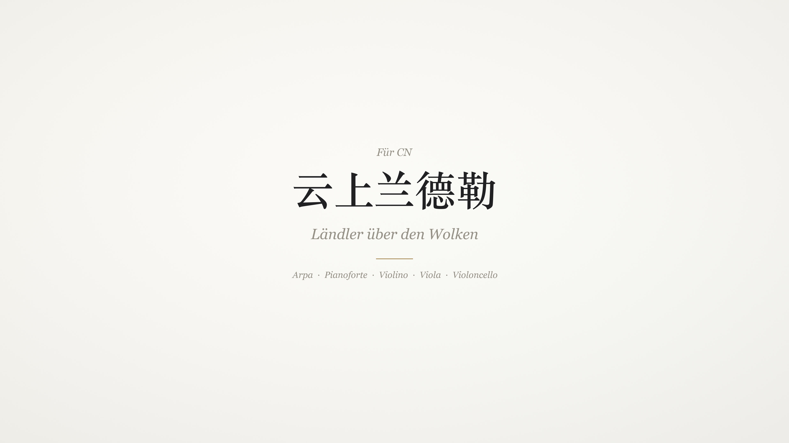

<em>Für CN</em>

<h1 align="center">云上兰德勒</h1>

<em>Ländler über den Wolken</em>

为独奏小提琴、竖琴、钢琴与弦乐而作 · D 大调 · 3/4 · 1′01″

<a href="https://hollis36.github.io/laendler-ueber-den-wolken/"><strong>展示页面</strong></a>

## 结构

| | 段落 | 时间 |
|---|---|---|
| | *Introduzione* 引子 | 0:00 |
| A | *Tema* 主题 | 0:04 |
| B | *Variazione* 变奏 | 0:13 |
| C | *Trio* 三声中部 | 0:22 |
| D | *Ripresa* 再现 | 0:38 |
| E | *Coda* 尾声 | 0:50 |

## 文件

| 文件 | 说明 |
|---|---|
| `score/…_score.pdf` | 总谱，A4，5 页 |
| `score/….mscz` / `.musicxml` | MuseScore 工程与通用乐谱格式 |
| `media/…_24bit-48kHz.wav` | 无损母带，24-bit / 48 kHz |
| `media/…_320k.mp3` | MP3 320 kbps，内嵌封面 |
| `media/…_4K-master.mp4` | 4K 演奏过程，3840 × 2160，H.264 High，AAC 320k |
| `media/…_1080p-web.mp4` | 网页播放用，1080p，约 1.2 Mbps |
| `media/…_1080p-light.mp4` | 网页播放用（慢速网络），1080p，约 0.5 Mbps |

同样的文件也附在 [Releases](https://github.com/Hollis36/laendler-ueber-den-wolken/releases) 中，另加一个封面版 MP4。

## 制作

- `source/pieces/hugo_alpine_long.py`：作曲，按小节写出每个声部的音符、力度和速度变化
- `source/render.py`、`score.py`、`room.py`：用真实乐器采样逐声部渲染、混响、混音与母带
- `source/to_score.py`、`engrave.py`：生成 MusicXML 总谱并套用出版版式
- `source/score_video.py`：生成 4K 随谱演奏视频与封面

采样：弦乐与竖琴来自 VSCO 2 Community Edition；钢琴来自 Salamander Grand Piano V3（Alexander Holm，CC BY 3.0）。

## 复现

按 [REPRODUCE.md](REPRODUCE.md) 准备环境后运行 `./reproduce.sh`，即可从源码重新生成全部成品。

## 版权

音乐、总谱与视频 © 2026，保留所有权利。
